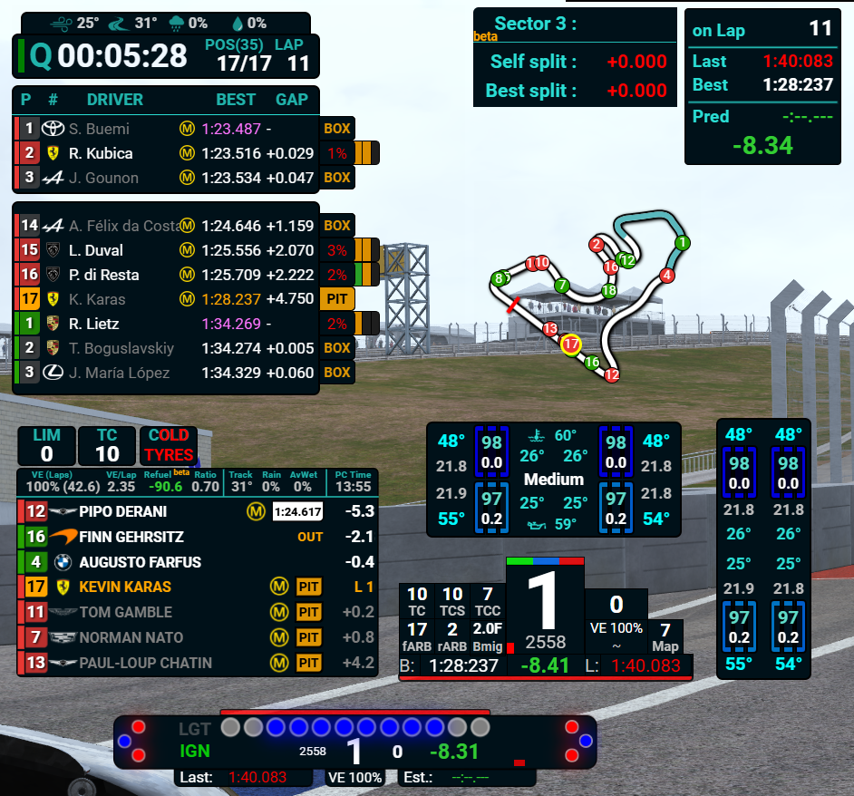
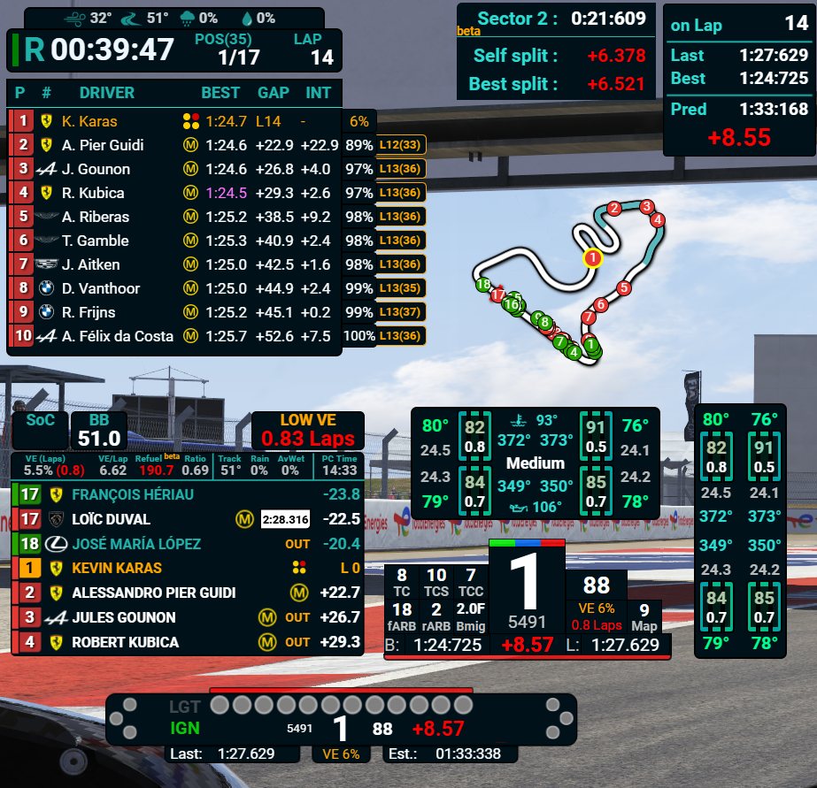

# MMO Plugin & Overlays for SimHub

A SimHub plugin and overlay suite for **Le Mans Ultimate (LMU)**, focused on modern multiclass racing. The plugin reads LMU shared-memory and API data and exposes it as SimHub properties for the accompanying overlays and custom dashboards.

The project is maintained by **Kevin_Karas**. The overlay suite builds on the original [LMU SimHub MMO Modern Multiclass Overlay](https://www.overtake.gg/downloads/lmu-simhub-mmo-modern-multiclass-overlay-standings-relative-tires.74112/).

## What the plugin provides

- Per-car overall and class positions, driver and team names, car number and class.
- Relative gaps ahead and behind, plus race gap and interval values.
- Lap timing, invalid-lap state, finish status, penalties and incidents.
- Pit status and the last pit lap and pit-lane stop duration.
- Tyre compounds for all four wheels, with cached values to avoid flickering.
- Player-specific properties that stay tied to the player's car rather than its current position.
- Player fuel and virtual-energy (VE) consumption estimates, laps remaining and the RefuelVE estimate.
- Configurable settings for leaderboard team names, relative team labels, tyre-compound symbols, and pit-stop information.
- A plugin page with live property values, version/update checks, and an overlay package page that compares installed overlay versions with the latest release.

The plugin publishes properties under the `MMOPlugin.MMO_...` namespace, including position-based properties and player-specific `MMO_Player...` values. Property values can be used directly in SimHub Dash Studio and NCalc formulas.

## Plugin pages

The plugin menu contains the following pages:

| Page | What it provides |
|---|---|
| **Plugin** | Searchable live properties. With no search term, the list stays empty; matching values refresh every 10 seconds while the SimHub window is in the foreground and pause in the background. **Hide empty properties** is enabled by default. |
| **Overlays** | Checks the latest available overlay ZIP and compares each dashboard's metadata version with the installed SimHub overlay. It offers individual or package-wide install/update actions. The plugin must be up to date before overlay updates can run. |
| **Settings** | Leaderboard and Relative display options, tyre-compound display rules, last-lap popup duration, TeamSpeak ClientQuery key, and optional debugging logs. The TeamSpeak key is masked by default and protected for the current Windows user. |
| **Controls** | Configure SimHub input bindings to increase or decrease the persistent FuelTarget in 0.02 steps. The target uses VE for cars with Virtual Energy and fuel otherwise. |
| **Data** | Per-car/per-track completed-lap statistics, best lap and its timestamp, average consumption, and FuelTarget. Filter by car and track, export/import a backup, reset all records, or right-click a record to delete it. The plugin also keeps the newest automatic statistics backup before plugin updates. |
| **Changelog** | Lists GitHub releases and their notes. A cached copy is available when GitHub cannot be reached. |

Overlay installation and updates are confirmed with a prompt. The plugin backs up its statistics before a plugin update and keeps only the newest automatic backup.

## Additional plugin features

- **Stint laps:** `StintLap` is available for the player and each car. It begins at the race start or garage exit, resets after a confirmed refuelling or tyre service, and does not reset for a drive-through or Stop-and-Go penalty.
- **Position changes:** `prevPosition` and `PositionGain` support position-change markers and configurable green/red name coding in race sessions.
- **Track-limit incidents:** `MMO_PlayerIncidents` and `MMO_IncidentsLimit` expose the player's current incident points and the session limit when LMU supplies them.
- **TeamSpeak 3:** Local ClientQuery integration exposes connection, server/channel, player and up to 15 client names, mute states, and live talking states. Configure the ClientQuery API key in Settings; it is stored protected for the current Windows user.
- **Consumption history:** Complete-lap fuel and VE samples are saved per car/track combination. Historical averages can supply a starting consumption value at the beginning of a session while live readings are not yet available.
## Overlay overview

The overlay package contains the following displays. Names and versions can vary between package releases.

| Overlay | Description |
|---|---|
| **MMO - Leaderboard** | Multiclass race standings with overall and class positions and supporting race-status indicators. |
| **MMO - Relative** | Cars ahead and behind with relative gaps; includes team-name variants and race fuel/VE information where available. |
| **MMO - LapInfo** | Compact lap and timing information, including lap-time context such as outlaps. |
| **MMO - MiniCarData** | A compact per-car information display for use alongside the main leaderboard or relative. |
| **MMO - Notification Center** | A dedicated area for overlay and race notifications. |
| **MMO - Rev Bar** | Compact rev and shift-light display. |
| **MMO - SectorBox** | Sector-time information in a separate timing box. |
| **MMO - TireInfoHor** | Horizontal tyre telemetry widget, including tyre and brake temperatures, pressures, wear and compounds when supplied by LMU. |
| **MMO - TireInfoVer** | Vertical layout of the tyre telemetry widget. |
| **MMO - TrackMap** | Track map display. |
| **MMO - TeamSpeak** | A TeamSpeak overlay for the connected channel, client names, mute states, and talking indicators. |

The suite also includes leaderboard/relative variants and tyre displays described on the [original OverTake page](https://www.overtake.gg/downloads/lmu-simhub-mmo-modern-multiclass-overlay-standings-relative-tires.74112/). Available items depend on the overlay package version.

## Screenshots

**Q session / qualifying:**

**R session / race:**

## Install

1. Download the latest `MMOPlugin.dll` from [GitHub Releases](https://github.com/St54Kevin/MMOPlugin/releases) and install it in SimHub.
2. Restart SimHub if requested, then open the **MMO Plugin** page.
3. Open the **Overlays** tab and use its check/install controls to inspect and install the available overlays directly through the plugin.

You only need to download and install the plugin DLL manually. The plugin retrieves the latest overlay package itself; downloading or extracting the overlay ZIP separately is not required.

## Build from source

- Visual Studio with **.NET Framework 4.8** targeting support.
- SimHub installed, so the project can resolve its SimHub assemblies.

Open `MMOPlugin.slnx` and build the solution. If the project reports missing SimHub assembly references, update the reference paths in `MMOPlugin/MMOPlugin.csproj` to match your SimHub installation.

## Data availability

The plugin can only expose data that LMU provides through its shared memory or API. Some information, such as custom team names or certain car-specific values, may be unavailable or incomplete depending on the session and LMU data.

## License and attribution

This project is distributed under the **GNU General Public License v3.0 or later**. See [LICENSE](LICENSE) for the full license text.

Portions of the plugin calculations are adapted from [TinyPedal](https://github.com/TinyPedal/TinyPedal), Copyright (C) 2022-2026 TinyPedal developers. TinyPedal is licensed under GPL-3.0-or-later. This plugin's related implementation has been modified for SimHub and Le Mans Ultimate.

The plugin and overlay suite are maintained by Kevin_Karas. Third-party libraries and assets remain subject to their own licenses.

## Credits

- **Plugin and overlay suite:** Kevin_Karas
- **Original overlay release and feature background:** [OverTake.gg](https://www.overtake.gg/downloads/lmu-simhub-mmo-modern-multiclass-overlay-standings-relative-tires.74112/)

